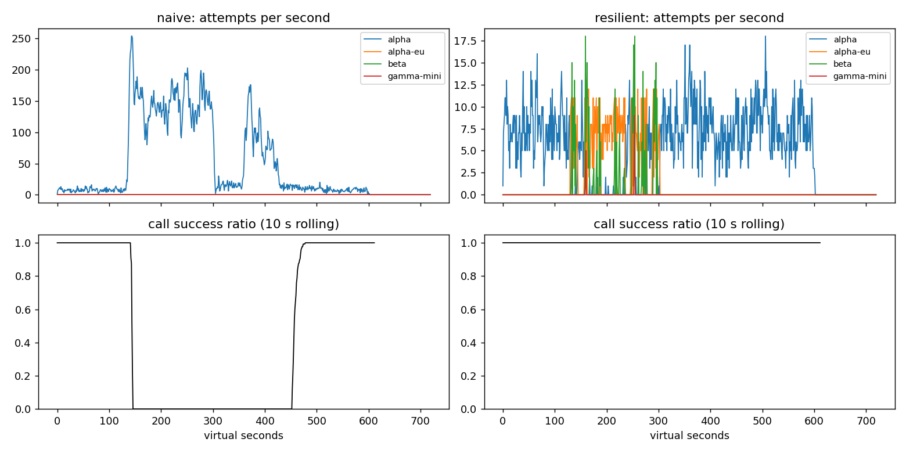

# Lab 25B — Game Day

**Họ tên:** Phùng Trọng Chiến · **MSV:** 2A202602430

**Commit:** Chưa tạo commit nộp bài · **Điểm tự động:** 84/88 trên dữ liệu công khai; 4 điểm SLO còn chờ dữ liệu ẩn.

## 1. Kết quả Game Day

| Băng | Client | Availability | p95 (s) | Amplification | Retry ratio | Cost/lượt thành công | Recovery (s) | Kết quả |
|---|---|---:|---:|---:|---:|---:|---:|---|
| G1 | naive | 0,7194 | 7,157 | 7,738 | 6,738 | 2,163 | 4 | FAIL |
| G1 | resilient | 1,0000 | 4,776 | 1,062 | 0,002 | 2,101 | 0 | PASS |
| G2 | naive | 0,4560 | 15,034 | 9,904 | 8,904 | 4,627 | 155 | FAIL |
| G2 | resilient | 1,0000 | 11,217 | 1,044 | 0,005 | 2,129 | 0 | PASS |
| G3 | naive | 1,0000 | 4,768 | 1,164 | 0,164 | 2,328 | 0 | FAIL |
| G3 | resilient | 1,0000 | 4,718 | 1,065 | 0,035 | 2,146 | 0 | PASS |
| G4 | naive | 1,0000 | 13,764 | 1,004 | 0,004 | 2,008 | 0 | FAIL |
| G4 | resilient | 1,0000 | 5,684 | 1,013 | 0,002 | 2,069 | 0 | PASS |
| G5 | naive | 0,3699 | 5,359 | 17,030 | 16,030 | 2,124 | — | FAIL |
| G5 | resilient | 0,8179 | 5,477 | 1,003 | 0,002 | 2,504 | — | PASS |
| G6 | naive | 0,5170 | 4,836 | 12,344 | 11,344 | 2,009 | 0 | FAIL |
| G6 | resilient | 1,0000 | 5,958 | 1,053 | 0,019 | 2,203 | 0 | PASS |

Ở G1, client mới không vi phạm `retry-after` lần nào; bản naive vi phạm 36.027 lần. G5 không retry lỗi 400 và không failover vô ích. G6 không gửi tool call sang model thiếu tool calling.

## 2. Cấu hình client

| Tham số | Giá trị | Căn cứ |
|---|---:|---|
| `attempt_timeout_s` | 8 s | G6 đạt availability 1,0000; tăng lên 30 s làm giảm còn 0,9488 vì lượt treo hết hạn trước khi chuyển provider. |
| `max_attempts_per_provider` | 2 | G2 chỉ cần amplification 1,044; retry nhiều hơn khiến tải dồn lại provider yếu. |
| `min_time_left_s` | 1 s | Không gửi thêm attempt khi deadline 30 s đã gần hết. |
| `backoff_base_s` / `backoff_cap_s` | 0,25 / 4 s | Full jitter phân tán retry; G1 có 0 vi phạm `retry-after`. |
| `retry_budget_ratio` / `min_per_s` / `max_tokens` | 0,1 / 0,5 / 20 | Khi vô hiệu breaker trên G2, budget giữ amplification ở 1,378 thay vì 1,675. |
| `quota_cooldown_s` | 300 s | G5 bỏ qua provider hết quota và đạt availability 0,8179. |
| `breaker.window_size` / `min_calls` | 20 / 10 | Chỉ quyết định sau đủ mẫu; G4 phát hiện call chậm mà không cần lỗi HTTP. |
| `failure_rate_threshold` / `slow_rate_threshold` | 0,5 / 0,6 | G2 chuyển tải khi lỗi tăng; G4 giảm p95 từ 13,764 xuống 5,684 s. |
| `slow_call_s` / `open_duration_s` | 5 / 10 s | Bắt vùng chậm ở G4; sau 10 s thử lại để traffic quay về `alpha`. |
| `half_open_max_probes` / `half_open_successes` | 2 / 2 | Chỉ cho hai phép thử đồng thời trước khi đóng breaker. |

Luồng xử lý là **nhận lỗi → phân loại → cập nhật breaker nếu lỗi phản ánh sức khỏe provider → quyết định attempt kế tiếp**. Lỗi 400 dừng ngay. Hết quota đặt cooldown 300 s; 429 rate limit đặt cooldown đến `retry-after`, rồi chuyển provider. Lỗi 529, 5xx hoặc timeout có thể retry cùng provider sau full jitter nếu còn lượt, budget và deadline; nếu không thì chuyển provider. Khi mọi tuyến đều bận, client chỉ đợi một rate limit ngắn tối đa 5 s. Tool call chỉ đi `alpha`, `alpha-eu` hoặc `beta`.

## 3. Ba thí nghiệm

**Retry budget.** Tôi đặt `breaker.min_calls=1000000000` và cho phép 5 attempt/provider. Với budget bật, G2 có amplification 1,378, retry ratio 0,058, recovery 0 s; tắt budget thì các số lần lượt là 1,675, 0,495 và 25 s, availability giảm từ 0,9983 xuống 0,9666. Ở G3, retry ratio tăng từ 0,068 lên 0,159 khi tắt budget. Với breaker hoạt động bình thường, G2 chỉ còn amplification 1,044, nhưng budget vẫn chặn retry storm nếu breaker bị cấu hình sai hoặc chưa đủ mẫu để mở.

**Timeout 30 giây.** G6 với timeout 8 s đạt availability 1,0000; timeout 30 s chỉ đạt 0,9488 và có 122 lượt `GiveUp("deadline")`. p95 của lượt thành công giảm từ 5,958 xuống 5,362 s vì các lượt treo bị loại khỏi mẫu p95, không phải vì trải nghiệm tốt hơn. G4 gần như không đổi: availability vẫn 1,0000, p95 từ 5,684 xuống 5,608 s, vì vùng chậm vẫn trả lời trước 30 s. Timeout nên đủ cho p99 lúc bình thường nhưng phải chừa thời gian chuyển provider trong deadline 30 s của người dùng.

**Bỏ lọc tool calling.** Với G6, bỏ điều kiện `supports_tools` làm 235 tool call đi vào `gamma-mini`; cả 235 lượt kết thúc bằng `incompatible_model_output`. Availability giảm từ 1,0000 xuống 0,9015. Với sản phẩm, đó là 235 yêu cầu hoàn tiền mà model được chọn không thể thực hiện bước gọi công cụ cần thiết.

## 4. Workflow hoàn tiền

| Executor | Hoàn tất | Worker crash | Hoàn tiền trùng | Email trùng | Hoàn tiền bị mất | Trả dư (cent) | LLM lãng phí/crash |
|---|---:|---:|---:|---:|---:|---:|---:|
| naive | 1,0000 | 81 | 128 | 81 | 0 | 1.496.700 | 1,123 |
| yours | 1,0000 | 66 | 0 | 0 | 0 | 0 | 0,303 |

Mỗi bước được khoanh bằng khóa `(session_id, step)`. Khi chạy lại, executor tìm checkpoint của bước đó; có kết quả thì đọc tiếp, chưa có thì gọi service và lưu kết quả sau khi thành công. Idempotency key giữ nguyên qua retry và restart, nên payment hoặc email đã thực hiện nhưng mất response vẫn trả lại cùng kết quả. Chỉ có key thì các bước LLM trước đó vẫn bị làm lại sau crash; chỉ có checkpoint thì crash giữa lúc tiền đã đi và lúc ghi checkpoint có thể hoàn tiền lần nữa. Ghi checkpoint trước khi gọi payment còn nguy hiểm hơn: worker có thể chết trước khi tiền đi, trong khi lần sau lại bỏ qua bước này.

## 5. Alerting và error budget

| Sự cố | Mong đợi | Naive | Burn-rate | Trễ phát hiện của burn-rate |
|---|---|---|---|---:|
| `checkout_bug` | page | page | page | 27 phút |
| `provider_outage` | page | page | page | 4 phút |
| `deploy_blip` | không báo | page sai | không báo | — |
| `slow_leak` | ticket | bỏ sót | ticket | 1.337 phút |
| `degraded_evening` | page | page | page | 291 phút |
| `night_spike` | không báo | page sai | không báo | — |
| `small_bump` | không báo | page sai | không báo | — |

Trong 30 ngày có 25.901.755 request; ngân sách lỗi cho SLO 99,5% là 129.508,8 request. Có 55.618 request lỗi, tương đương tiêu 42,95% ngân sách và còn 57,05%, nên chưa đóng băng release. `small_bump` kéo dài 20 phút với 12% lỗi: cửa sổ 1 giờ chỉ có khoảng 4% lỗi, burn rate khoảng 8×, dưới ngưỡng page 14,4×; cửa sổ 6 giờ cũng dưới ngưỡng 6×. Một blip như vậy không đáng đánh thức on-call.

## 6. Postmortem G2 — retry storm trên bản naive

Trong băng G2, `alpha` mất 75% năng lực ở giây 120 và phục hồi ở giây 300. Client naive tiếp tục đẩy retry vào cùng provider; tải attempt tăng từ vài request/giây lên hơn 100 request/giây, làm hàng đợi không thoát được. Hệ thống chỉ đạt lại tỷ lệ thành công 95% sau thêm 155 giây tính từ lúc provider phục hồi.

Có 2.362 lượt người dùng, trong đó 1.285 lượt thất bại; availability chỉ 45,60%. Sự cố đối với người dùng kéo dài xấp xỉ từ giây 120 đến giây 455. Nếu lấy mức 4 lượt/giây của bài lab cho cả tháng 30 ngày, ngân sách lỗi tháng là 51.840 lượt; riêng G2 đã tiêu 1.285/51.840, tức 2,48% ngân sách đó.

| Giây ảo | Diễn biến | Số liệu từ CSV, trong đúng giây đó |
|---:|---|---|
| 120 | `alpha` bắt đầu mất năng lực | 5 attempt vào `alpha`; 7/7 call hoàn tất thành công, gồm call đã xử lý trước đó. |
| 150 | Retry bắt đầu lấn át năng lực | 163 attempt; 0/3 call thành công. |
| 180 | Hàng đợi tiếp tục nghẹt | 138 attempt; 0/5 call thành công. |
| 240 | Tải vẫn cao giữa sự cố | 105 attempt; 0/2 call thành công. |
| 300 | Provider phục hồi năng lực | 115 attempt; 0/5 call thành công. |
| 390 | Provider đã phục hồi nhưng hệ thống chưa thoát nghẹt | 139 attempt; 0/6 call thành công. |
| 450 | Tải retry bắt đầu giảm | 16 attempt; 0/3 call thành công. |
| 480 | Call thành công trở lại | 8 attempt; 11/11 call hoàn tất thành công. |

Mất GPU là **tác nhân khởi phát**. **Nguyên nhân gốc** là ba tầng retry chồng nhau, delay cố định, không budget, không breaker và không chuyển provider. Chúng khuếch đại 3.481 logical call thành 34.475 attempt, tức 9,904 attempt/call. Client timeout không hủy công việc đang nằm trong hàng đợi provider; retry mới lại vào hàng đợi đó. Vì vậy sau giây 300, provider đã có đủ GPU nhưng vẫn xử lý nhiều request mà client cũ đã bỏ, trong khi retry mới tiếp tục giữ tải cao. Đây là vòng lặp tự duy trì khiến phục hồi chậm.

Mô phỏng và CSV giúp tách rõ thời điểm provider hồi phục khỏi thời điểm người dùng thấy dịch vụ hồi phục. Việc chỉ retry trên `alpha` làm tình hình tệ hơn; `alpha-eu` và `beta` không được dùng dù còn năng lực. Client mới giữ amplification G2 ở 1,044 và recovery 0 s.

| Hành động | Loại | Owner | Cách kiểm chứng |
|---|---|---|---|
| Giữ một tầng retry có jitter và budget trong client | prevent | Nhóm ứng dụng | CI chạy G2 với amplification ≤ 1,2 và retry ratio ≤ 0,10. |
| Theo dõi attempt/logical call, queue wait và tỷ lệ timeout theo provider | detect | Nhóm vận hành | Dashboard và cảnh báo khi amplification vượt 1,6 trong G2; không chỉ nhìn HTTP 5xx. |
| Dùng breaker và fallback có kiểm tra tool calling | mitigate | Nhóm nền tảng | G2 recovery ≤ 30 s; G6 có 0 incompatible route trên nhiều seed. |

## 7. Điểm yếu còn lại

Ở G2, p95 của client mới vẫn là 11,217 s dù availability đạt 100%; một số lượt phải chờ timeout hoặc chuyển vùng. Tôi sẽ đo p99 bình thường và thời gian chờ hàng đợi theo provider để hạ timeout có kiểm soát, sau đó chạy lại G2 và G6; mục tiêu là giảm p95 mà vẫn giữ availability và recovery đạt ngưỡng.

## 8. Cache

| Client trên C1 | Availability | FAQ availability | Hit ratio | Trả stale | Trả sai | Trả cũ | Cost/lượt thành công | Kết quả |
|---|---:|---:|---:|---:|---:|---:|---:|---|
| resilient, không cache | 0,8373 | 0,8424 | 0 | 0 | 0 | 0 | 1,386 | FAIL |
| cached | 0,9124 | 0,9645 | 0,652 | 157 | 0 | 3 | 0,915 | PASS |

| Tham số cache | Giá trị | Căn cứ |
|---|---:|---|
| `similarity_threshold` | 0,95 | Ở 0,80 có 175 câu trả nhầm câu hỏi khác; 0,95 còn 0 câu sai và hit ratio 0,652. |
| `ttl_s` | 60 s | TTL 300 s làm 95 câu lỗi thời sau thay đổi không báo trước; 60 s chỉ còn 3. |
| `max_stale_s` | 600 s | Bao phủ 120 s mọi provider sập; tắt stale làm FAQ availability giảm từ 0,9645 xuống 0,8733. |
| `max_entries` | 500 | Đủ chứa các câu FAQ trong băng; LRU giữ kích thước cache có giới hạn. |

Khi tìm cache, tôi khoanh trước `prompt_version`, bỏ câu hỏi cá nhân, rồi chọn embedding giống nhất vượt ngưỡng. Hit còn trong TTL được trả ngay; hit đã cũ chỉ được dùng khi provider bỏ cuộc. Webhook xóa mọi câu trả lời dựa trên tài liệu vừa thay đổi.

**Ngưỡng similarity.** Cùng TTL 60 s, ngưỡng 0,80 cho hit ratio 0,659, 175 câu sai và cost/lượt 0,978. Ở 0,95, các số là 0,652, 0 và 0,915; ở 0,97 là 0,579, 0 và 0,965. Các cặp gần về chữ nhưng khác ý như chính sách hoàn tiền và thời gian nhận tiền hoàn có thể bị gộp khi ngưỡng quá lỏng; cả 175 lỗi ở 0,80 thuộc `other_question`.

**TTL.** Với TTL 30/60/300 s, số câu lỗi thời lần lượt là 2/3/95, hit ratio 0,592/0,652/0,731 và cost/lượt 0,955/0,915/0,863. Webhook ở giây 150 xóa câu trả lời dựa trên chính sách hoàn tiền đã đổi. Bảng phí ship đổi ở giây 480 không gửi webhook; chỉ thời hạn TTL buộc cache hỏi lại provider để lấy nội dung mới.

**Stale-if-error.** Tắt cửa sổ stale làm FAQ availability từ 0,9645 giảm xuống 0,8733 và số câu phục vụ stale từ 157 xuống 0. Cache cũ chỉ là lối thoát khi mọi provider không trả lời; câu đã bị webhook vô hiệu hoặc khác `prompt_version` không được dùng lại.

Câu hỏi cá nhân không được cache ngay cả khi khóa theo user: trạng thái đơn hàng và số tiền hoàn có thể đổi liên tục, còn câu gần giống nhau giữa các đơn dễ gây trả nhầm dữ liệu nhạy cảm. Trong lúc cache giữ FAQ availability ở 96,45%, on-call vẫn cần xem lỗi provider, trạng thái breaker, số lượt `stale_served` và tuổi câu trả lời; một dashboard chỉ nhìn tỷ lệ câu FAQ được trả sẽ che mất sự cố provider.
